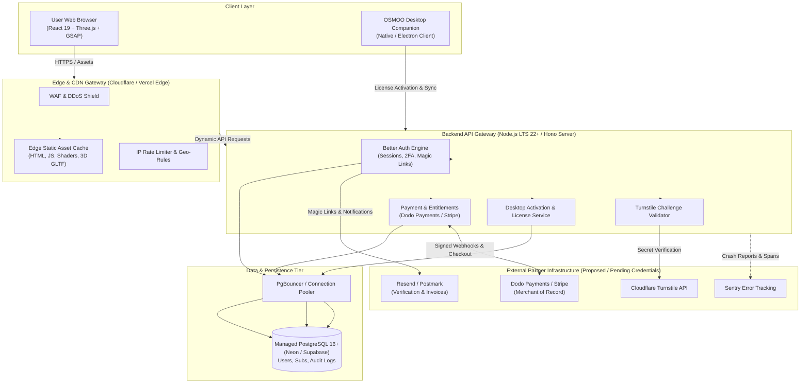
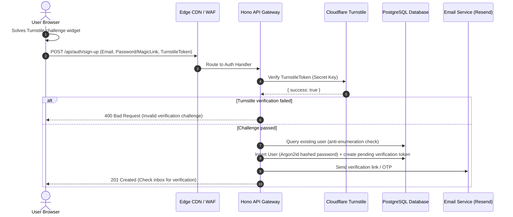
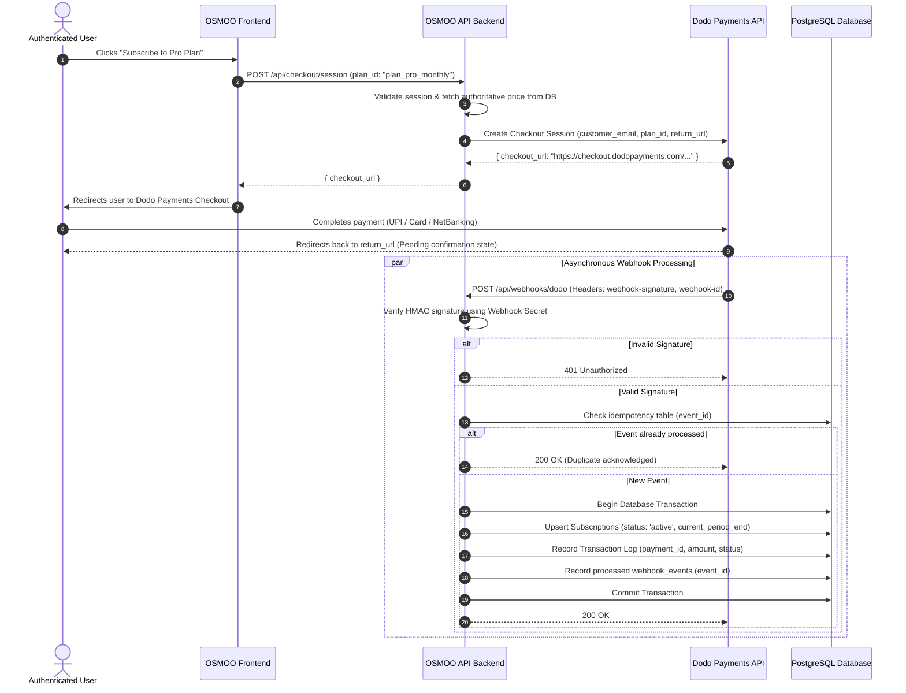

# OSMOO — System Architecture & Component Interactions

**Status:** Architecture Specification  
**Project:** OSMOO (Osmiora Computational Systems)  
**Document:** `docs/ARCHITECTURE.md`  

---

## 1. System Topology Overview

OSMOO is designed as a distributed, secure system bridging high-performance marketing/onboarding web experiences, a resilient subscription/entitlement backend, and future desktop application clients.

---

## 2. Component Interaction & Data Flows

### 2.1 Web Presentation & 3D Canvas Mounting Flow
1. **Initial Page Delivery**: The user's browser requests `https://osmoo.in`. Cloudflare / Vercel Edge serves the pre-compressed HTML shell, CSS, and hashed JS chunks (`stale-while-revalidate`).
2. **Smooth Scroll & Animation Binding**:
   - `Lenis` initializes the smooth scrolling context on window DOM.
   - `GSAP ScrollTrigger` registers callbacks hooked into `Lenis`'s requestAnimationFrame (RAF) ticker.
3. **WebGL Canvas Initialization**:
   - `Canvas` mounts asynchronously without blocking primary hero text rendering.
   - WebGL capability detection tests for `WebGL2RenderingContext`.
   - If WebGL fails or crashes, a graceful CSS poster fallback renders.
   - 3D assets (Draco-compressed `.glb`, environment maps) load progressively using Drei's `useGLTF.preload`.

---

### 2.2 User Registration & Authentication Flow

---

### 2.3 Subscription Checkout & Webhook Entitlement Flow

---

### 2.4 Desktop Companion Device Linking Flow
1. **Device Identification**: The OSMOO desktop app generates an ephemeral device code and hardware fingerprint.
2. **Browser Pairing**: The user visits `https://osmoo.in/pair` while logged in and enters the device code.
3. **Cryptographic Token Issuance**: The server verifies the active subscription, writes a `device_sessions` record, and returns a signed Ed25519 or JWT refresh token to the desktop app.
4. **Heartbeat & Entitlement Check**: The desktop application periodically checks entitlement validity with the server every 24 hours. If canceled or past due, access gracefully downgrades.
