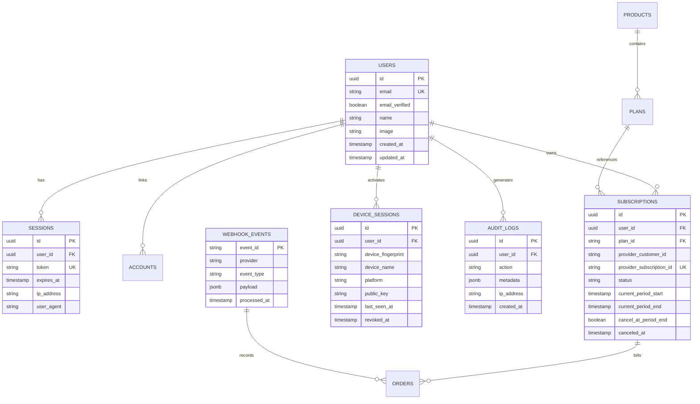

# OSMOO — Database Architecture, Schema & Access Boundaries

**Status:** Data Architecture Specification  
**Project:** OSMOO (Osmiora Computational Systems)  
**Document:** `docs/DATABASE.md`  

---

## 1. Database Selection & Access Architecture

- **Primary Database Engine**: Managed PostgreSQL 16+ (Neon Serverless PostgreSQL or Supabase).
- **Access Layer / ORM**: **Drizzle ORM (`^0.39.0`)**.
- **Migration Engine**: `drizzle-kit` running declarative TypeScript migrations.
- **Connection Strategy**: Transaction pooling via PgBouncer / Neon Serverless connection pooler. Eliminates connection exhaustion during high-concurrency traffic spikes.

---

## 2. Relational Schema Proposal

---

## 3. Data Sensitivity, Retention & Privacy Matrix

| Table / Entity | Sensitivity Level | Access Permissions | Retention Policy | Data Minimization Notes |
| :--- | :--- | :--- | :--- | :--- |
| **`users`** | High (PII) | Owner, Authorized Backend Service | Retained until user initiates account deletion | Zero passwords stored in plaintext; hashed with Argon2id. |
| **`sessions`** | Critical (Auth Token) | Backend Auth Middleware only | Deleted automatically upon expiration or user sign-out | Encrypted / high-entropy tokens only. |
| **`subscriptions`** | High (Financial Entitlement) | Owner (read-only), Payment Webhook (write) | Retained for lifetime of account + 7 years (tax audits) | No card numbers stored; references only provider customer & subscription IDs. |
| **`device_sessions`** | Medium (Hardware Metadata) | Owner, License Validation API | Retained until device revoked or 180 days inactive | Device IDs are non-reversible cryptographic hashes. |
| **`webhook_events`** | High (Payload verification) | Internal Webhook processor only | 90 days rolling retention | Strips any direct payment credentials from raw logs. |
| **`audit_logs`** | High (Security trail) | Append-only; Security Admin review | 1 year rolling audit retention | Anonymized IP addresses; no auth secrets logged. |

---

## 4. Isolation, Migrations & Backup Strategy

1. **Environment Isolation**:
   - `Development`: Local PostgreSQL instance or isolated Neon developer branch.
   - `Preview / Staging`: Dedicated staging database branch with test payment records.
   - `Production`: Dedicated, isolated production database with multi-zone automated backups and PITR (Point-in-Time Recovery) enabled.
2. **Schema Migration Discipline**:
   - Migrations are versioned SQL scripts generated by `drizzle-kit generate`.
   - Migrations run in CI/CD release phase prior to container/edge switchover.
   - Backward-compatible schema evolution: add columns with defaults; deprecate before dropping.
3. **Account Deletion & Data Erasure**:
   - Upon confirmed user deletion, a cascading soft-delete flags the account, cancels provider subscriptions, and purges all active session and device credentials within 24 hours.
