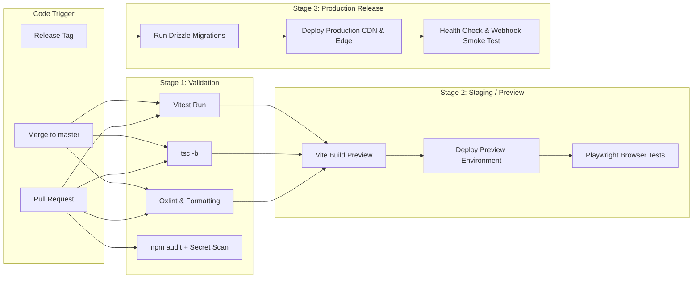

# OSMOO — Deployment, CI/CD, DNS, CDN & Caching Strategy

**Status:** Deployment & Infrastructure Specification  
**Project:** OSMOO (Osmiora Computational Systems)  
**Document:** `docs/DEPLOYMENT.md`  

---

## 1. Domain & DNS Architecture (`osmoo.in`)

### 1.1 DNS Status Audit
- **Verified Current State**: DNS resolution (`nslookup osmoo.in`) currently returns `Non-existent domain (NXDOMAIN)`.
- **Status**: **Unverified / External Blocker**. (NXDOMAIN indicates no active authoritative DNS response at queried nameservers; it does not determine whether the domain name is purchased or parked at a registrar).
- **Requirement**: Domain ownership must be confirmed at the registrar (e.g., INRegistry-accredited registrar), and nameservers delegated to the chosen DNS provider (Cloudflare recommended) before issuing SSL/TLS certificates.

### 1.2 Target DNS Zone Records Configuration
```zone
; OSMOO Authoritative DNS Records Proposal (Cloudflare Managed DNS)
@               IN      A       76.76.21.21         ; (or CNAME to Vercel/Cloudflare Edge)
@               IN      AAAA    ...                 ; IPv6 Edge Anycast
www             IN      CNAME   osmoo.in.           ; Canonical apex redirect
api             IN      CNAME   osmoo.in.           ; Or dedicated API cluster
_turnstile      IN      TXT     "..."               ; Cloudflare site verification
@               IN      CAA     0 issue "letsencrypt.org"
@               IN      CAA     0 issue "digicert.com"
@               IN      CAA     0 issuewild ";"     ; Disallow wildcard certificates
```
- **DNSSEC**: Must be enabled at the registrar to prevent DNS spoofing and cache poisoning.

---

## 2. CDN, Edge Caching & Cache-Control Policies

| Resource Type | Cache Location | Header Specification | Invalidation & Refresh Rule |
| :--- | :--- | :--- | :--- |
| **HTML Shell (`index.html`)** | Edge CDN + Browser | `Cache-Control: public, max-age=0, must-revalidate` | Always validates ETag; instant rollout of newly deployed builds. |
| **Hashed JS/CSS (`/assets/*.js`)** | Edge CDN + Browser | `Cache-Control: public, max-age=31536000, immutable` | Permanent cache; cache-busting handled automatically via Vite hash. |
| **3D Assets & Shaders (`.glb`, `.hdr`)** | Edge CDN + Browser | `Cache-Control: public, max-age=86400, stale-while-revalidate=604800` | Edge cached globally; pre-compressed with Brotli/Gzip. |
| **Authenticated API (`/api/auth/*`)** | **NO CACHE** | `Cache-Control: no-store, no-cache, must-revalidate, private` | Browser and CDN must never cache session tokens or user details. |
| **Payment & Checkout (`/api/checkout/*`)** | **NO CACHE** | `Cache-Control: no-store, private` | Zero caching; guarantees fresh price and session generation. |

---

## 2.1 SPA Routing Fallback vs. Backend API Route Exclusions

Because OSMOO's frontend is a client-side Single Page Application (SPA), routing logic is managed by the client router in the browser. 

### Provider-Specific Rewrite Rules:
- **Cloudflare Pages (`_redirects` / `_routes.json`)**:
  ```text
  # Direct API traffic to backend without HTML fallback
  /api/*  https://api.osmoo.in/api/:splat  200
  # SPA catch-all for client-side pages
  /*      /index.html                     200
  ```
- **Vercel (`vercel.json`)**:
  ```json
  {
    "rewrites": [
      { "source": "/api/(.*)", "destination": "/api/$1" },
      { "source": "/(.*)", "destination": "/index.html" }
    ]
  }
  ```

### Critical API Isolation Rule:
> **API requests (`/api/*`, `/api/webhooks/*`) must NEVER be rewritten to `index.html`.** If an API route does not exist or fails, the server must return a structured JSON 404/500 error (`{"success": false, "error": {"code": "NOT_FOUND"}}`), never an HTML document. Returning HTML to automated webhook dispatchers or API clients causes silent parsing failures.

### Direct Navigation Test Matrix:
Before promoting any release to production, the following direct browser URLs must be verified:
1. `https://osmoo.in/` — Renders primary hero experience.
2. `https://osmoo.in/pair` — Renders desktop application linking view without 404.
3. `https://osmoo.in/account` — Redirects unauthenticated users to `/login` or renders dashboard.
4. `https://osmoo.in/checkout/return?session_id=mock` — Renders payment confirmation loader.
5. `https://osmoo.in/non-existent-page` — Renders branded 404 client view, not raw web server 404.
6. `https://osmoo.in/api/health` — Returns JSON health status, never `index.html`.

---

## 3. Production CI/CD Pipeline Design



### Key Security & Governance Rules:
1. **Branch Protection**: Direct pushes to `master` blocked; require PR with 1 approving review and all Stage 1 status checks passing.
2. **Secret Scoping**: Production credentials (`DODO_WEBHOOK_SECRET`, `DATABASE_URL`) are scoped strictly to the `production` environment and unavailable to pull-request preview builds.
3. **Automated Rollback**: If health checks fail post-deployment, the Edge router reverts traffic to the previous immutable deployment hash within 10 seconds.
