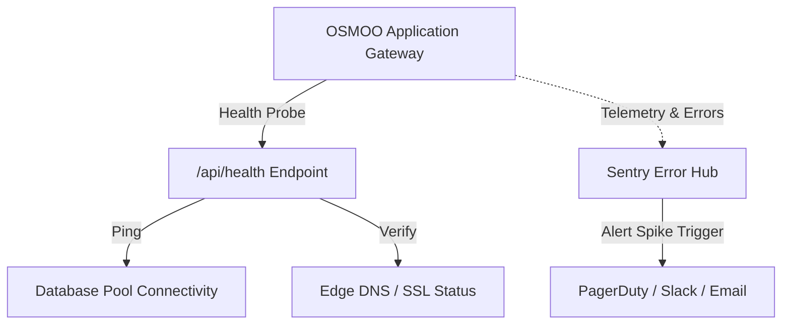

# OSMOO — Error Handling, Logging & Observability Architecture

**Status:** Observability Specification  
**Project:** OSMOO (Osmiora Computational Systems)  
**Document:** `docs/OBSERVABILITY.md`  

---

## 1. Unified Error Handling Architecture

### 1.1 API Error Model
All backend endpoints return standardized, structured error responses:

```json
{
  "success": false,
  "error": {
    "code": "PAYMENT_AUTHORIZATION_FAILED",
    "message": "The transaction was declined by the card issuer.",
    "requestId": "req_01j7x8a9...",
    "timestamp": "2026-10-12T06:05:00.000Z"
  }
}
```
- **Internal details (stack traces, SQL errors, database table names) are stripped** before responses leave the backend gateway.
- Every incoming request generates a unique `X-Request-Id` (UUID v7 or nanoid) propagated across database logs and external provider metadata.

### 1.2 Frontend React 19 Error Boundaries
1. **Global App Boundary**: Catches top-level routing or shell failures and displays a branded, accessible recovery page ("We encountered an unexpected issue").
2. **WebGL / Canvas Boundary**: Wraps Three.js / R3F Canvas components. If the GPU crashes (`WEBGL_context_lost`), the boundary catches the exception and renders an ultra-clean static CSS/SVG interactive fallback without bringing down the rest of the page.

---

## 2. Structured Logging & Redaction Policy

All logs are written to `stdout` in JSON format for automated ingestion:

```json
{
  "level": "info",
  "requestId": "req_01j7x8a9",
  "timestamp": "2026-10-12T06:05:00.000Z",
  "route": "/api/checkout/session",
  "method": "POST",
  "status": 200,
  "durationMs": 42,
  "userId": "usr_99812..."
}
```

### Strict Redaction Filters:
- Headers: `Authorization`, `Cookie`, `webhook-signature` are scrubbed.
- Body: `password`, `token`, `cardNumber`, `cvv`, `otp` fields are automatically masked as `[REDACTED]`.

---

## 3. Monitoring, Health Checks & Alert Thresholds



### Health Check Endpoint (`/api/health`):
- Checks database connectivity via `SELECT 1;`.
- Checks memory usage and event loop latency.
- Returns `200 OK` (healthy) or `503 Service Unavailable` (unhealthy) for load balancer traffic routing.

### Operational Alerting Rules:
- **Critical Alert**: > 3 consecutive webhook delivery failures or signature rejections within 5 minutes.
- **High Alert**: Error rate exceeding 1% of total HTTP requests over a 10-minute sliding window.
- **Medium Alert**: WebGL fallback triggered by > 5% of visiting desktop clients.
