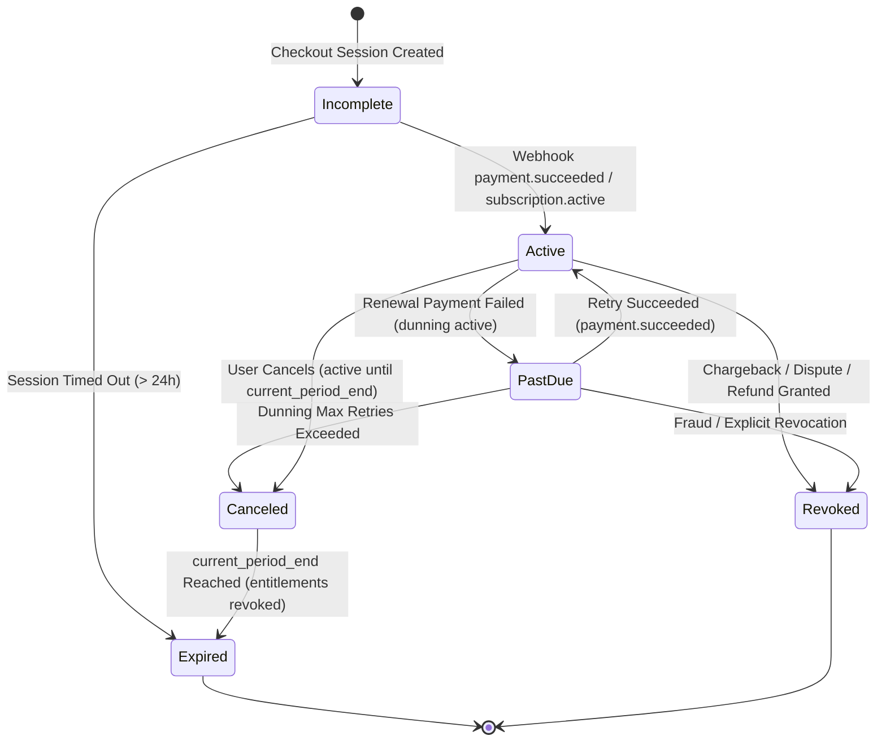

# OSMOO — Payment Provider, Subscription & Entitlements Architecture

**Status:** Payment & Entitlement Specification  
**Project:** OSMOO (Osmiora Computational Systems)  
**Document:** `docs/PAYMENTS.md`  

---

## 1. Provider Audit & Candidate Evaluation

| Evaluation Criteria | Dodo Payments (Primary Candidate) | Stripe (International Secondary) | Razorpay (India Specialized) |
| :--- | :--- | :--- | :--- |
| **Merchant of Record (MoR)** | **Yes** (Handles global tax, VAT/GST filing, invoicing, compliance) | No (Requires company to manage local VAT/GST tax registrations) | No (Direct gateway; requires Indian business tax filing) |
| **India Recurring (RBI Compliance)** | **Yes** (Built-in support for RBI recurring mandates via UPI Autopay and Indian Cards) | Challenging for Indian cards due to e-mandate authentication limits | Yes (UPI Autopay & e-mandates supported) |
| **Global Currency Settlement** | USD, EUR, GBP, INR settlement | Global multi-currency | Primarily INR focused (cross-border complex) |
| **Pricing Model** | ~4% + $0.40 per transaction; zero monthly platform fee | 2.9% + $0.30 (US) / 2% (India) + tax management costs | 2% - 3% + GST |
| **Webhook Security** | HMAC SHA-256 with timestamp tolerance & event IDs | HMAC SHA-256 with timestamp tolerance & event IDs | Secret signature verification |
| **Recommendation** | **Primary Choice for OSMOO** | **Documented Fallback** | **Alternative for local UPI only** |

---

## 2. Authoritative Server-Side Entitlement Rule

> **CRITICAL ARCHITECTURAL INVARIANT:**  
> The frontend browser, return URL, and local client state are NEVER trusted as the source of truth for paid access. Entitlement privileges (`access_level: 'pro' | 'enterprise'`) are granted exclusively through verified database records written by cryptographic webhook handlers or server-to-server API reconciliation.

---

## 3. Subscription Entitlement State Machine



### State Definitions & Entitlement Mapping:
- **`incomplete`**: Checkout generated, waiting for first payment. Entitlement: **FREE / NONE**.
- **`active`**: Paid and valid. Entitlement: **PRO ACCESS GRANTED**.
- **`past_due`**: Renewal payment failed. Grace period active (e.g. 3-day grace window before disabling features). Entitlement: **PRO (TEMPORARY GRACE)**.
- **`canceled`**: User chose not to renew. Entitlement remains **PRO** until `current_period_end`, then transitions to `expired`.
- **`expired`**: Subscription period ended without renewal. Entitlement: **REVOKED (DOWNGRADE TO FREE)**.
- **`revoked`**: Manual refund or fraudulent chargeback. Entitlement: **IMMEDIATELY TERMINATED**.

---

## 4. Webhook Ingestion, Idempotency & Replay Protection

### 4.1 Required Verification Headers
1. `webhook-signature`: HMAC-SHA256 signature generated using the shared endpoint secret.
2. `webhook-id`: Unique identifier for each event delivery attempt.
3. `webhook-timestamp`: Epoch timestamp of event dispatch. Requests with timestamps older than 300 seconds are rejected to eliminate replay attacks.

### 4.2 Idempotency Pipeline
```typescript
// Conceptual Server Flow for /api/webhooks/dodo
// 1. Verify HMAC Signature
const isValid = verifyDodoSignature(rawBody, headers['webhook-signature'], process.env.DODO_WEBHOOK_SECRET);
if (!isValid) return response(401, 'Invalid signature');

// 2. Prevent Replay via Timestamp Check
if (Math.abs(Date.now() - Number(headers['webhook-timestamp'])) > 300_000) {
  return response(400, 'Expired webhook timestamp');
}

// 3. Atomically Record & Claim Event in Database
const claimed = await db.transaction(async (tx) => {
  const existing = await tx.query.webhookEvents.findFirst({
    where: eq(webhookEvents.eventId, headers['webhook-id'])
  });
  if (existing) return false; // Already handled

  await tx.insert(webhookEvents).values({
    eventId: headers['webhook-id'],
    provider: 'dodo_payments',
    eventType: event.type,
    processedAt: new Date(),
    payload: event
  });
  
  // 4. Update Subscription & Customer Entitlements
  await syncSubscriptionState(tx, event);
  return true;
});

return response(200, { received: true });
```

---

## 5. Dispute, Chargeback & Reconciliation Strategy

1. **Dispute Events (`dispute.opened`, `dispute.lost`)**: Immediately place subscription into `revoked` state, logging an audit record.
2. **Scheduled Reconciliation Cron**: Run a daily reconciliation job querying the provider API for subscriptions whose `current_period_end` has elapsed without an incoming webhook event. This guarantees entitlement state consistency even during temporary webhook provider outages.

---

## 6. Deterministic Mock Checkout & Webhook Test Strategy

Prior to receiving production credentials or merchant account approval, the entire payment lifecycle must be verified locally using deterministic test suites (Vitest):

### 6.1 Unit & Integration Test Matrix:
1. **Valid Signature Verification**:
   - Generates simulated payload with known test secret.
   - Computes HMAC-SHA256 hash.
   - Verifies server handler accepts and parses the body.
2. **Invalid Signature Rejection**:
   - Sends payload with tampered body or incorrect secret.
   - Asserts server responds immediately with `401 Unauthorized` without modifying database state.
3. **Replay & Timestamp Expiry**:
   - Sends valid signature with `webhook-timestamp` older than 300 seconds.
   - Asserts server responds with `400 Bad Request` (expired timestamp).
4. **Idempotency & Duplicate Deliveries**:
   - Dispatches the identical `webhook-id` twice in succession.
   - Verifies the first request commits database records and returns `200 OK`.
   - Verifies the duplicate request recognizes the existing ID, skips state mutation, and safely returns `200 OK`.
5. **Out-of-Order Webhook Protection**:
   - Simulates receiving a `subscription.cancelled` event followed late by an out-of-order `subscription.active` renewal event.
   - Asserts the entitlement state engine compares event creation timestamps before downgrading or upgrading entitlements.
6. **Zero Client Trust Invariant**:
   - Simulates user arriving at `/checkout/success?session_id=fake_123`.
   - Asserts user profile entitlement remains `free` until a server-side verified webhook or direct API reconciliation query confirms payment in PostgreSQL.

> **Test Status Distinction**:
> - **Mock / Synthetic Tests**: Can be executed 100% offline via Vitest test suites.
> - **Live Provider Integration Tests**: **Pending Merchant Account & Live/Sandbox API Keys**.

